# Agent UI

A modern chat interface for AgentOS built with Next.js, Tailwind CSS, and TypeScript. This template provides a ready-to-use UI for connecting to and interacting with your AgentOS instances through the Agno platform.


## Features

- **Overview**: AgentOS health, component counts, Factory revision, recent sessions and independently retried pending-work sources.
- **Agents and Teams**: Search by name, ID and model; inspect runtime and Factory definitions, tools, skills, members and Workflow references.
- **Workflows**: Tree and graph views of sequences, conditions and parallel groups, with step paths and relationships. Narrow screens open step details in a keyboard-accessible dialog.
- **Tools, Skills and Models**: Browse runtime tool schemas, Factory skills and their Agent references, and models reported by AgentOS.
- **Sessions and Runs**: Filter and inspect Agent, Team and Workflow sessions and runs, step results and available compaction metadata; links preserve supported filters.
- **Data**: Read-only Knowledge, Memory and Learnings views distinguish empty, unavailable and failed sources.
- **Observability**: Native traces, daily and operational metrics, and read-only evaluations. Missing token totals and unavailable costs are explicitly identified.
- **System and integrations**: AgentOS configuration, registry and independent health checks for the configured local integrations.
- 🔎 **Workflow and Agent Explorer**: Inspect workflow branches, parallel steps and Agent/Team details. See the [integration guide and screenshots](docs/workflow-explorer.md) for the required Factory backend endpoints.
- 🔗 **AgentOS Integration**: Seamlessly connect to local and live AgentOS instances
- 💬 **Modern Chat Interface**: Clean design with real-time streaming support
- 🧩 **Tool Calls Support**: Visualizes agent tool calls and their results
- 🧠 **Reasoning Steps**: Displays agent reasoning process (when available)
- 📚 **References Support**: Show sources used by the agent
- 🖼️ **Multi-modality Support**: Handles various content types including images, video, and audio
- 🎨 **Customizable UI**: Built with Tailwind CSS for easy styling
- 🧰 **Built with Modern Stack**: Next.js, TypeScript, shadcn/ui, Framer Motion, and more

## Version Support

This fork is integrated and partially verified with the AI Software Factory Lab POC on AgentOS **3.2.1**. Factory definitions require the POC's `/factory/*` endpoints; other deployments can expose fewer capabilities. See the [POC capability plan](https://github.com/CletusLee/AI-Software-Factory-Lab/blob/main/pocs/agno/docs/agent-ui-capability-plan.md) for detailed scope and open acceptance items.

## Screenshots

These repository images document earlier Docker UI checkpoints, including Agno 2.9.0. They illustrate the layouts; they are not evidence of the current 3.2.1 production image. The 3.2.1 browser checks and screenshot export limitation are recorded in the POC verification evidence.

### Workflow parallel steps — narrow screen

The Workflow explorer stacks parallel verification steps vertically on a narrow viewport, keeping each Agent and its step label readable.

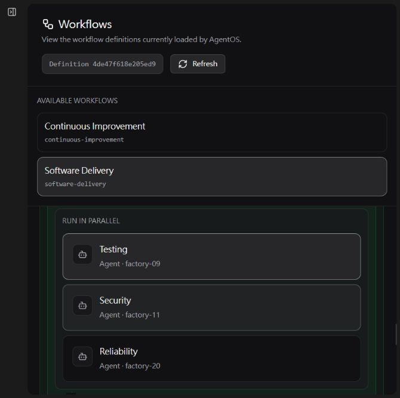

### Software Delivery workflow definition

The desktop Workflow explorer shows the Software Delivery definition, including its sequence, conditional branches and parallel groups.

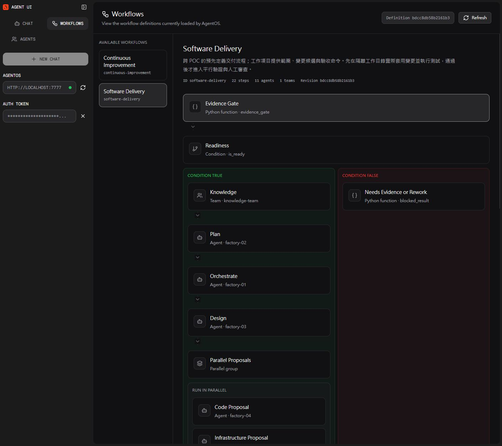

### Agent details

Selecting a Workflow Agent opens its details, including the Agent's role and available definition information.

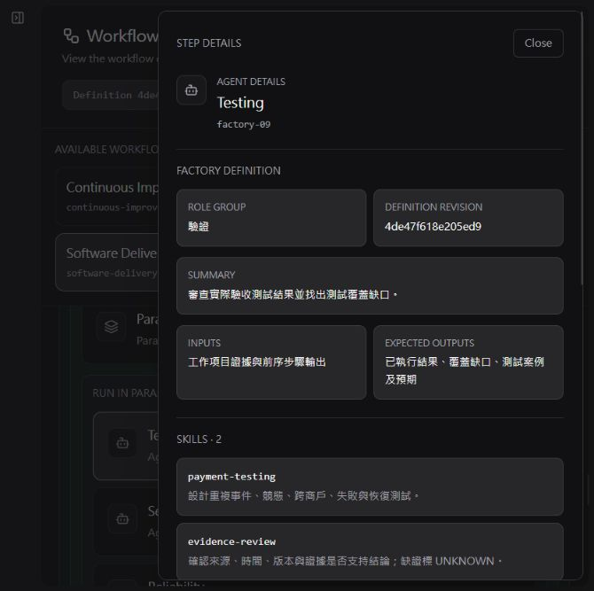

### Testing Agent runtime tools

The Testing Agent runtime view lists tools returned by AgentOS and their descriptions. This is an example of inspecting tools associated with a component.

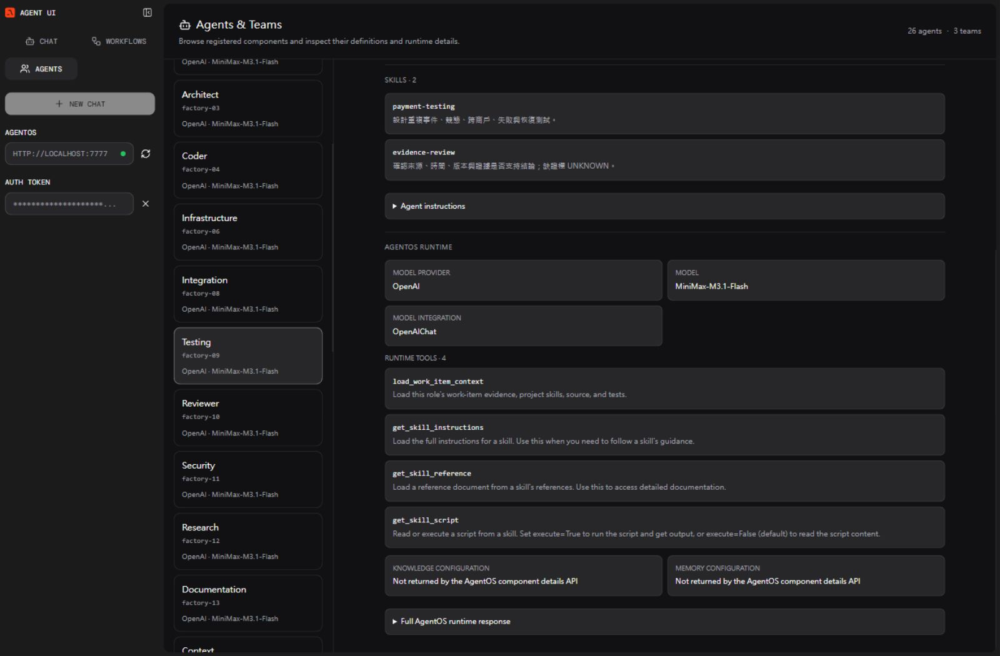

### Observability Team details

The Team detail view presents the Observability Team and its available definition and member information. Members can be used to navigate to Agent details.

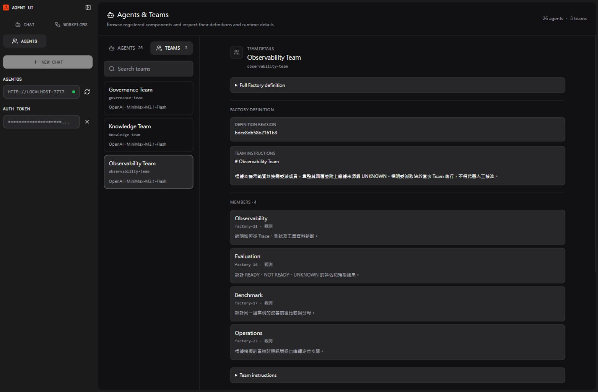

### Sessions and database filter

The Sessions and Runs explorer provides a database selector and filters for finding saved sessions and their associated runs.

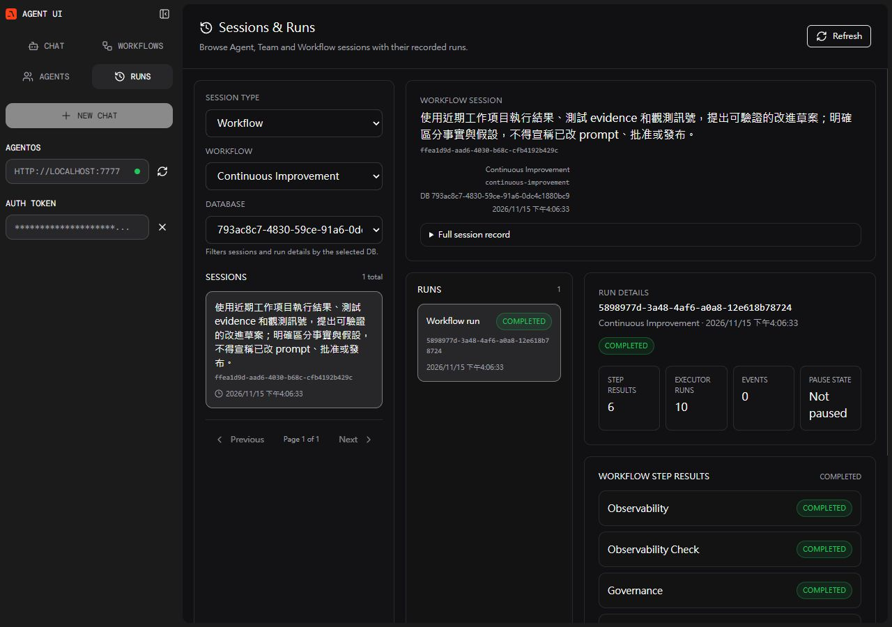

### Run details — narrow screen

The run detail view shows a selected Agent run and its available execution details in a narrow layout.

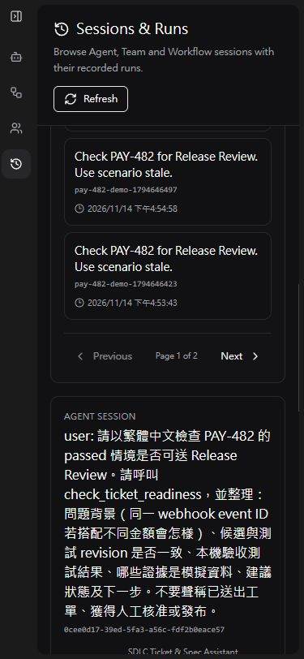

### Metrics dashboard

The Observability Metrics view displays daily AgentOS metrics for the selected date range, including run, session and token summaries when provided by the API.

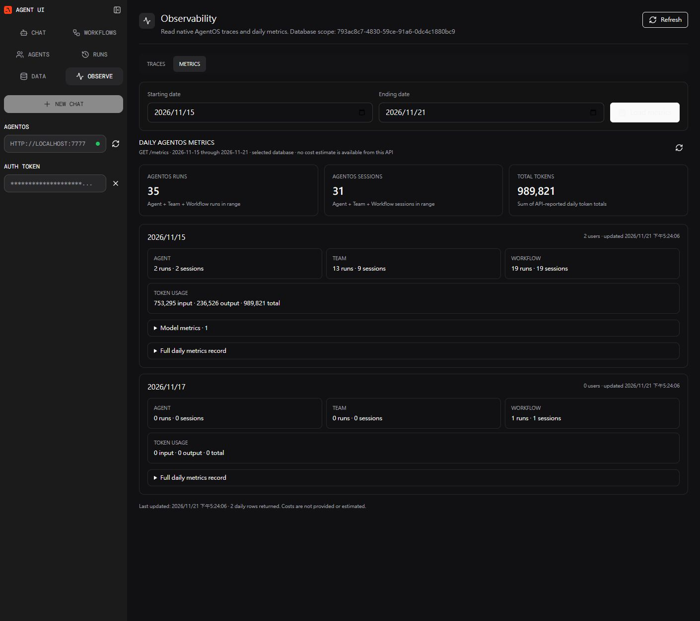

### Run-to-Trace filter — empty result

Following a run's trace link opens Observability with that run ID as a filter. This example shows a successful query with no matching native traces.

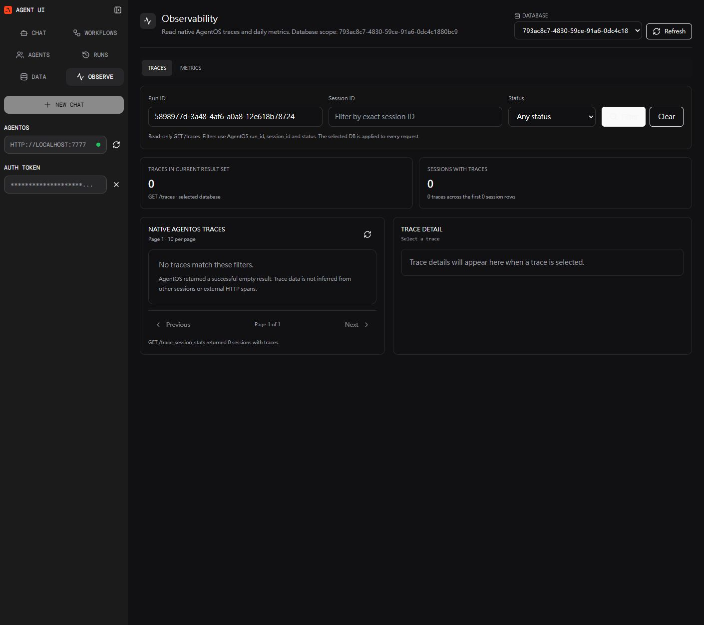

### Memory — empty state

The Data explorer's Memory tab distinguishes a successful empty list from an unavailable or failed data source.

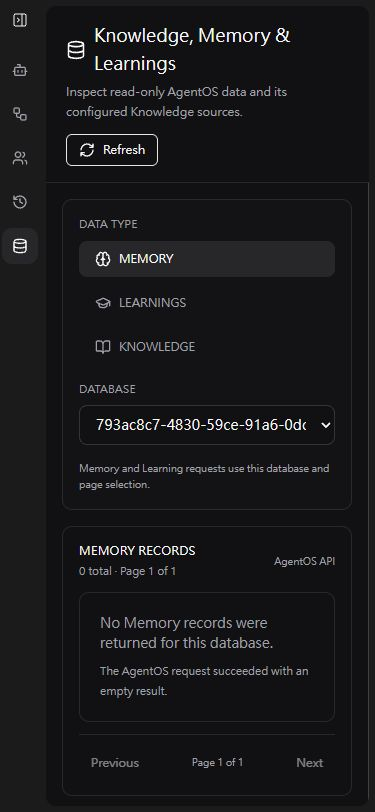

### Knowledge — configuration unavailable

The Knowledge view explains that a Knowledge instance is not configured for the selected database, while retaining the available navigation and retry controls.

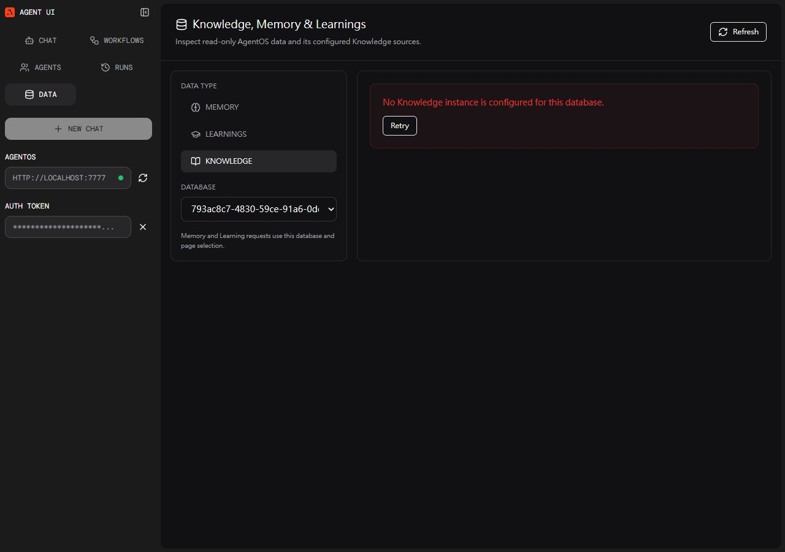

### System explorer

The System view groups deployment health, registered components, storage, models and integration status so their sources can be inspected separately.

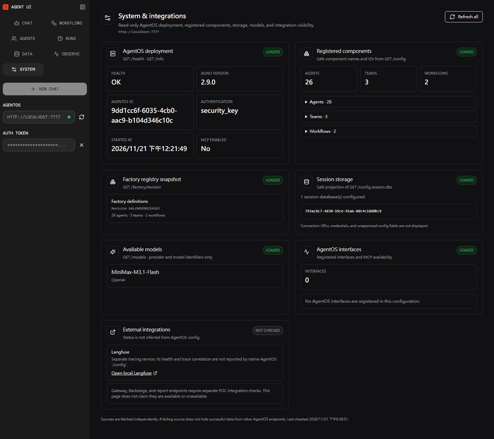

## Current delivery and limitations

The POC runs this fork through a pinned upstream checkout plus its `agent-ui.patch`. It provides a Docker bind-mounted development overlay for source iteration and a production image for deployment. The latest local production image is `sha256:0a11f3d38a56df8924319a513a7c05f8395da99c123d901c3c28e55f3775465f`; image IDs are local build results and can differ on another machine.

Several features remain partial: real Knowledge, Memory, Learning, Trace and Evaluation records are needed for positive-data verification; some AgentOS management services return 503 in this POC; Workflow execution, historical graph highlighting, real stream abort and full accessibility checks remain open. Metrics costs are not supplied by the current API. The POC capability plan and verification evidence track the exact remaining scope.

## Getting Started

### Prerequisites

Before setting up Agent UI, you need a running AgentOS instance. If you haven't created one yet, check out our [Creating Your First OS](/agent-os/creating-your-first-os) guide.

> **Note**: Agent UI connects to AgentOS instances through the Agno platform. Make sure your AgentOS is running before attempting to connect.

### Installation

### POC Docker deployment

For the integrated Factory deployment, follow the POC README in `AI-Software-Factory-Lab/pocs/agno`. Its Compose file builds the pinned fork and applies `agent-ui.patch`; the development overlay mounts this checkout's source for iteration.

### Upstream template installation

The upstream generator creates the standard Agent UI template and does not include this fork's POC features.

```bash
npx create-agent-ui@latest
```

### Manual Installation

1. Clone the repository:

```bash
git clone https://github.com/CletusLee/agent-ui.git
cd agent-ui
```

2. Install dependencies:

```bash
pnpm install
```

3. Start the development server:

```bash
pnpm dev
```

4. Open [http://localhost:3000](http://localhost:3000) with your browser to see the result.

## Connecting to Your AgentOS

Agent UI connects directly to your AgentOS instance, allowing you to interact with your agents through a modern chat interface.

> **Prerequisites**: You need a running AgentOS instance before you can connect Agent UI to it. If you haven't created one yet, check out our [Creating Your First OS](https://docs.agno.com/agent-os/creating-your-first-os) guide.

## Step-by-Step Connection Process

### 1. Configure the Endpoint

By default, Agent UI connects to `http://localhost:7777`. You can easily change this by:

1. Hovering over the endpoint URL in the left sidebar
2. Clicking the edit option to modify the connection settings

### 2. Choose Your Environment

- **Local Development**: Use `http://localhost:7777` (default) or your custom local port
- **Production**: Enter your production AgentOS HTTPS URL

> **Warning**: Make sure your AgentOS is actually running on the specified endpoint before attempting to connect.

### 3. Configure Authentication (Optional)

If your AgentOS instance requires authentication, enter the existing token in the UI:

1. In the left sidebar, locate the "Auth Token" section
2. Click on the token field to edit it
3. Enter your authentication token
4. The token is held in browser memory and sent as a Bearer token to the configured AgentOS endpoint

Reloading clears the token. The POC production image does not inject a public token environment variable. For the POC's same-origin proxy, `AGENTOS_URL` is a server-side upstream setting; see the POC README for Docker commands.

### 4. Test the Connection

Once you've configured the endpoint:

1. The Agent UI will automatically attempt to connect to your AgentOS
2. If successful, you'll see your agents available in the chat interface
3. If there are connection issues, check that your AgentOS is running and accessible. Check out the troubleshooting guide [here](https://docs.agno.com/faq/agentos-connection)

## Contributing

Contributions are welcome! Please see [CONTRIBUTING.md](./CONTRIBUTING.md) for contribution guidelines.

## License

This project is licensed under the [MIT License](./LICENSE).
