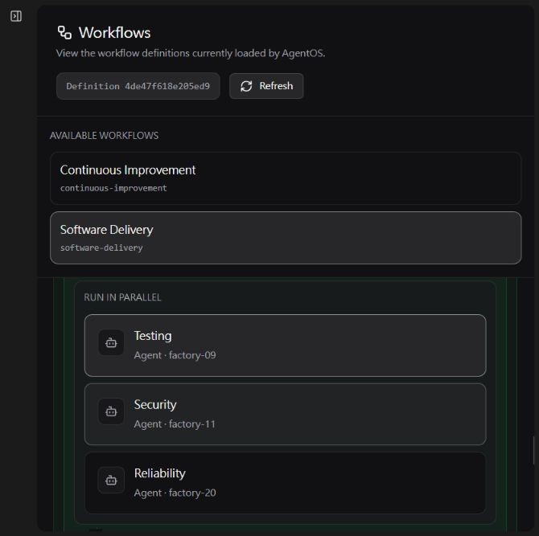
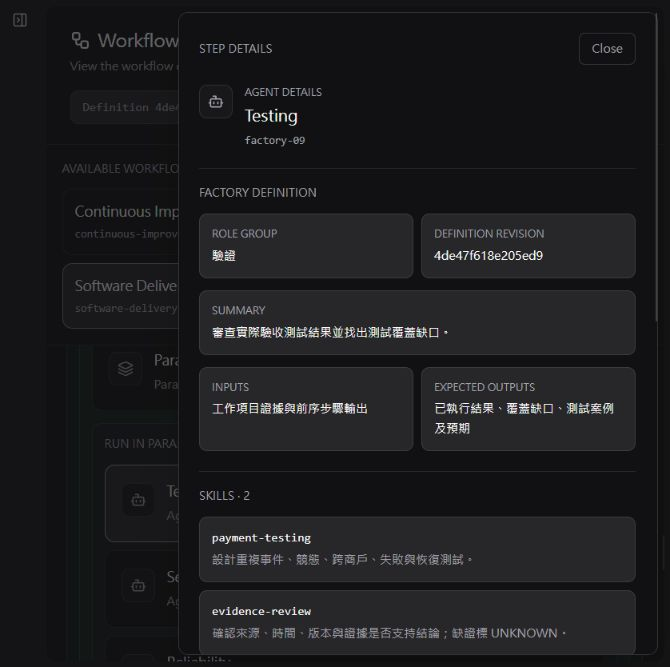

# Workflow and Agent explorer

This fork adds read-only **Workflows** and **Agents** views to Agent UI. The workflow view shows the deployed workflow definition, its revision, sequential steps, conditions and parallel groups. Selecting an Agent or Team opens its definition and available AgentOS runtime details; Team members link to their Agent details. The full workflow definition is also available in the view.

The layout responds to the space available inside each branch. Parallel members stack in narrow containers, and step details open in a separate panel on narrow screens. Switching between Agent and Team lists clears stale selections and resets detail state. Runtime tools support both the array and `{ tools: [...] }` response shapes.

## Screenshots

The screenshots show the Docker deployment with the Software Delivery workflow. The sidebar is collapsed.

## Backend requirements

Agent and Team runtime information comes from AgentOS. The workflow step tree and Factory-specific summaries, skills, instructions, members and revision require additional authenticated endpoints on the configured AgentOS server:

- `GET /factory/revision`
- `GET /factory/workflows/{workflow_id}`
- `GET /factory/agents/{agent_id}`
- `GET /factory/teams/{team_id}`

These `/factory` endpoints are specific to the [AI Software Factory Lab](https://github.com/CletusLee/AI-Software-Factory-Lab) integration; they are not standard AgentOS endpoints. The companion [backend patch](integration/agno-factory-backend.patch) adds the three detail routes to that project's `pocs/agno-tempo/app.py`; the base project already provides the revision endpoint and registry. Apply it from that project's root against commit `b671c63` with `git apply --unidiff-zero /path/to/agno-factory-backend.patch`, or adapt it to the current backend. Rebuild the AgentOS image after applying it. AgentOS authentication must cover these routes. Avoid exposing secrets in returned definitions.

On a server without the Factory endpoints, the UI reports that the Factory definition is unavailable; AgentOS runtime details can still load separately where supported. Knowledge and memory configuration are marked unavailable when the component API does not supply them.

## Validation and limitations

The UI patch was built in the Docker Compose deployment using the pinned upstream commit. TypeScript, ESLint, Prettier and the production build passed. Browser checks covered both workflows, Team-to-Agent navigation, Agent details and the parallel group at narrow widths, including a 590 px CSS viewport. Actual browser zoom at 125% and the missing-workflow and disconnected-server error screens have not yet been checked in the browser. Workflow editing, publishing and execution tracing are outside this read-only view.
